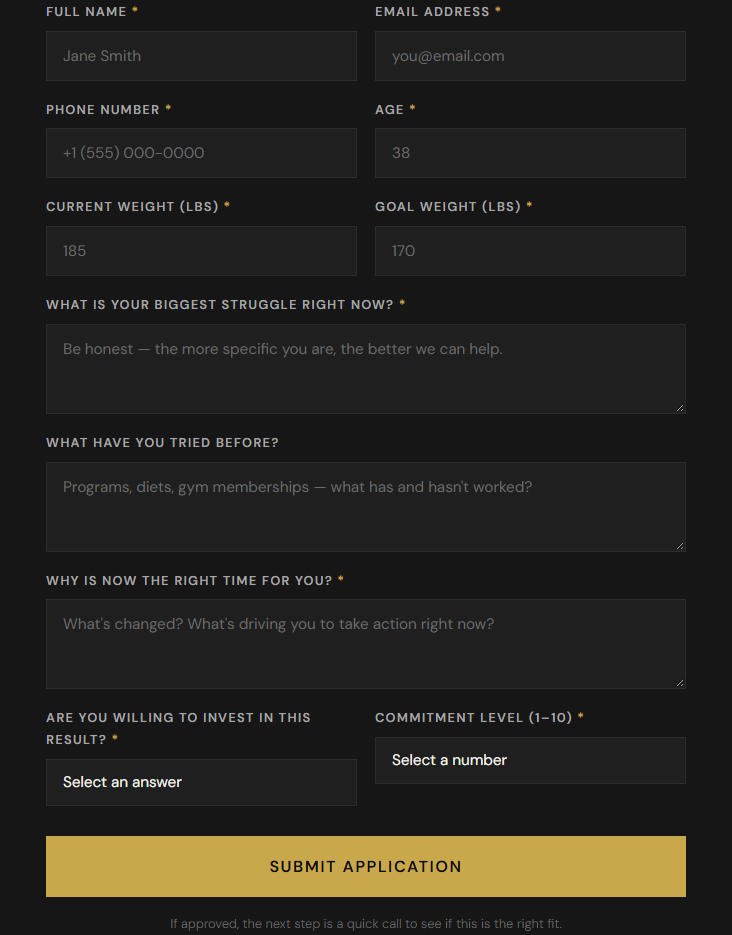

# 28-day coaching landing page

A personal landing-page prototype for adults considering a short fitness-coaching program. It explores how to explain an offer, address concerns about time and consistency, and guide an interested visitor toward an application.

**Status:** front-end prototype. The form checks inputs and displays a confirmation locally. It does not send an application, save a lead or connect to a CRM. The page's testimonials, weight-loss promises and limited-place messaging are unverified sample copy, not evidence of my results or an active coaching service.

## What to inspect

Open [index.html](../index.html) to review the complete page: HTML, CSS, JavaScript and an embedded image are in one file.

| Reader's question | Page section | What it demonstrates |
| --- | --- | --- |
| Is this relevant to me? | Audience fit and problem sections | Connecting the offer to a visitor's concerns. |
| What would I get? | Nutrition, training and accountability sections | Making a service easier to understand. |
| What might stop me? | Objection section | Anticipating questions before the application. |
| What happens next? | Application and confirmation | Form design and browser-side validation. |

## My contribution and AI support

This is one of my personal projects built with AI tools. I approached it as a marketer exploring offer presentation and the path from interest to application. AI supported the implementation. The inspectable work here is the page's messaging, structure and browser behavior; the repository does not document which AI tool produced each part.

## Preview it locally

Download the repository and open `index.html` in a browser. No build step, package installation or API key is needed. Google Fonts needs internet access; the page has fallback fonts.

Alternatively, with Python installed, run this from the repository folder:

```sh
python -m http.server 8000 --bind 127.0.0.1
```

Then open `http://127.0.0.1:8000` in your browser. Use dummy values when inspecting the form. A valid submission only hides the form and reveals the local confirmation; no application is delivered.



## Tools visible in the project

- HTML and CSS, including responsive layouts and media queries.
- Plain JavaScript for scroll reveals, validation and the confirmation state.
- Google Fonts: Bebas Neue, DM Sans and DM Serif Display.

The file contains no backend integration, analytics or experiment results. Supabase is used in my separate private projects, not in this page.

## What this exercise surfaces

The page makes a concrete tradeoff visible: the application asks about goals, obstacles and commitment, but each additional required field adds effort. A useful next experiment would compare this form with a shorter first step and measure completion and lead quality. No such test is documented here.

The confirmation also exposes a product lesson: a message saying an application was received needs a real delivery mechanism behind it. Before using this as a live funnel, replace or substantiate the sample claims and testimonials, connect and verify form delivery, and provide appropriate data-handling information.

See my [profile](https://github.com/tjcraw21) for other projects.
